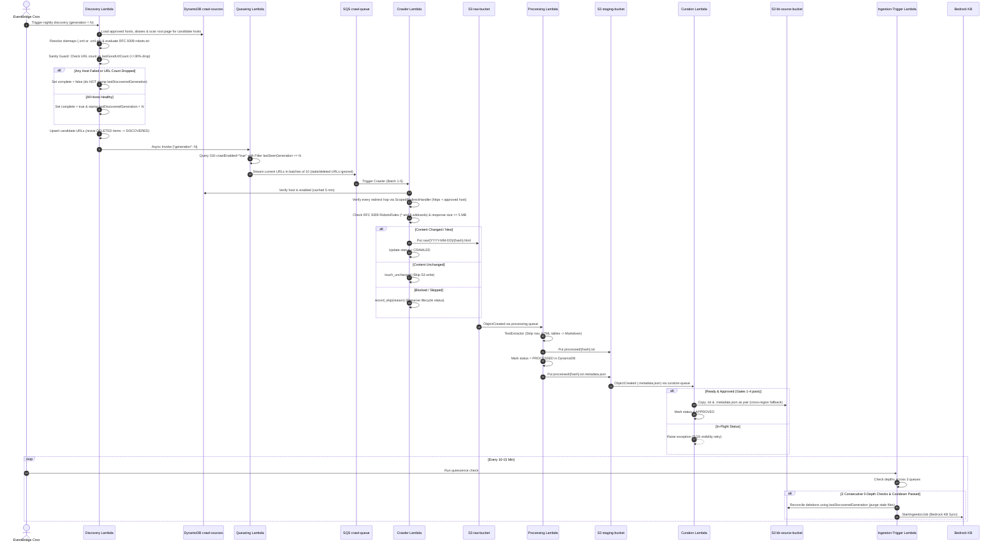
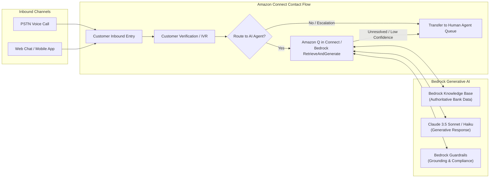

# Low-Level Design (LLD): Custom Web Crawler to Amazon Bedrock Knowledge Base & Amazon Connect AI Agent

**Document Version:** 2.0  
**Status:** Approved / Production-Ready  
**Target Platform:** Amazon Web Services (AWS)  
**Author:** Engineering Team  
**Date:** October 2026  

---

## 1. Executive Summary & Solution Objectives

This Low-Level Design (LLD) document details the architecture, component specifications, data schemas, algorithmic logic, and integration patterns for an enterprise-grade web content crawler and generative RAG (Retrieval-Augmented Generation) pipeline.

The solution automatically discovers, crawls, sanitizes, curates, and synchronizes authoritative banking website content into **Amazon Bedrock Knowledge Bases**. The synchronized knowledge is subsequently served in real-time to customers and contact center agents through **Amazon Connect AI Agents** across voice and digital channels (Web Chat, Mobile App, WhatsApp).

### Primary Objectives
1. **Accurate, Grounded Self-Service**: Enable the Amazon Connect AI Agent to answer customer queries (fixed deposit rates, loan criteria, service charges, digital banking guidelines) with zero hallucinations, backed by verifiable `sourceUrl` citations.
2. **Financial Table Integrity**: Preserve tabular data relationships (interest rate slabs, tenure matrix) via HTML-to-Markdown conversion so Bedrock semantic chunking retains table structures intact.
3. **Multi-Stage Defense-in-Depth Curation & Scoping**:
   * **Domain & Host Governance**: Multi-host discovery via `crawl-sources` DynamoDB table; unvetted subdomains discovered on the site are registered as disabled candidates for human review.
   * **Zero-Trust Fetch Defense**: Crawler inspects every redirect hop (preventing redirection to SSO or off-site domains), verifies host enablement, enforces RFC 9309 robots.txt rules (supporting `*` wildcards and `$` anchors), and caps responses at 5 MB.
   * **Content Curation**: Content is gated before reaching the Knowledge Base via regex allowlists, denylists, and an administrative DynamoDB blocklist.
4. **Resilient Event-Driven Lifecycle & Completeness Guards**:
   * Stale/deleted URLs are excluded at queueing time by generation filtering (`lastSeenGeneration = generation`).
   * A 30% drop sanity check and completeness guard prevent incomplete discovery passes from accidentally triggering Knowledge Base deletions.
   * Deleted URLs that reappear on the bank's site are automatically revived to `DISCOVERED` with cleared content hashes.
5. **Seamless Omnichannel Integration**: Integrate with Amazon Connect using Amazon Q in Connect and native Bedrock `RetrieveAndGenerate` APIs within Amazon Connect Contact Flows.

---

## 2. End-to-End System Architecture

```mermaid
flowchart TD
    subgraph INGESTION["1. Ingestion Pipeline (AWS Serverless)"]
        direction TB
        SOURCES[("DynamoDB crawl-sources<br/>(Approved hosts, aliases, candidate subdomains)")]
        EB1["EventBridge Scheduler<br/>(Nightly Discovery Cron)"] --> L1["Discovery Lambda"]
        SOURCES <--> L1
        L1 -- Async Invoke {"generation": N} --> L2["Queueing Lambda"]
        L2 --> Q1[("SQS crawl-queue")]
        Q1 --> L3["Crawler Lambda"]
        SOURCES -. Cached Host Check .-> L3
        L3 --> S3_RAW[("S3 raw-bucket<br/>raw/YYYY-MM-DD/{hash}.html")]
        S3_RAW -- S3 ObjectCreated --> Q2[("SQS processing-queue")]
        Q2 --> L4["Processing Lambda"]
        L4 --> S3_STAGE[("S3 staging-bucket<br/>processed/{hash}.txt<br/>{hash}.txt.metadata.json")]
        S3_STAGE -- S3 ObjectCreated --> Q3[("SQS curation-queue")]
        Q3 --> L5["Curation Lambda"]
        L5 --> S3_KB[("S3 kb-source-bucket<br/>(Curated text + sidecars)")]
        
        EB2["EventBridge Scheduler<br/>(Every 10-15 Min)"] --> L6["Ingestion-Trigger Lambda"]
        L6 -- Monitor Depths --> Q1 & Q2 & Q3
        L6 -- Reconcile Deletions --> S3_KB
        L6 -- StartIngestionJob --> BEDROCK_SYNC["Amazon Bedrock<br/>Data Source Sync Job"]
    end

    subgraph BEDROCK["2. Bedrock Knowledge Base & RAG Layer"]
        direction TB
        BEDROCK_SYNC --> AOSS[("OpenSearch Serverless<br/>Vector Store (1536-dim)")]
        TITAN["Amazon Titan Embeddings V2<br/>(text-to-vector)"] <--> AOSS
        GUARDRAILS["Bedrock Guardrails<br/>(PII Redaction & Prompt Injection Filter)"]
    end

    subgraph CONNECT["3. Contact Center Runtime (Amazon Connect)"]
        direction TB
        CUSTOMER(["Customer<br/>(Voice / Web Chat / Mobile)"]) <--> FLOW["Amazon Connect<br/>Contact Flow"]
        FLOW <--> LEX["Amazon Lex V2 /<br/>Connect Speech Recognition"]
        FLOW <--> RAG_CALL["Bedrock RetrieveAndGenerate API<br/>or Amazon Q in Connect"]
        RAG_CALL <--> GUARDRAILS
        RAG_CALL <--> AOSS
        FLOW <--> AGENT(["Contact Center Agent<br/>(Connect Agent Workspace)"])
    end
```

---

## 3. Data Store Specifications & Schemas

### 3.1. DynamoDB: `crawl-sources` (Host Governance Table)
Acts as the central authority for all hostnames, domain aliases, and discovery configurations.

* **Partition Key**: `host` (String, e.g. `"www.bankofireland.com"`, `"business.bankofireland.com"`)

| Attribute Name | Type | Description |
| :--- | :--- | :--- |
| `host` | String | Primary Key: Fully-qualified domain name (lowercase). |
| `enabled` | String | `"true"` / `"false"`. Only hosts with `"true"` are crawled. Unvetted subdomains land here as `"false"` (CANDIDATE). |
| `origin` | String | How this host entered the table: `BOOTSTRAP`, `LINK_SCAN`, `SITEMAP_URL`, or `BOOTSTRAP_ALIAS`. |
| `aliasOf` | String | *(Optional)* If set, this host is an alias (e.g., apex domain `bankofireland.com` $\rightarrow$ `www.bankofireland.com`). Alias hosts are rewritten to the target and never crawled directly. |
| `sitemapUrls` | String / List | *(Optional)* Comma-separated list or List of sitemap URLs to use instead of automatic sitemap discovery. |
| `lastStatus` | String | Health status of host in latest discovery run: `OK` or `ERROR`. |
| `lastError` | String | Error message if discovery failed for this host. |
| `lastRunGeneration` | Number | Generation number of latest discovery pass. |
| `lastRunAt` | Number | Unix epoch timestamp of last run. |
| `lastGoodUrlCount` | Number | URL count from the last successful discovery run; drives the 30% drop sanity guard. |

---

### 3.2. DynamoDB: `content-registry`
Maintains the lifecycle state, hashes, and validation history for every discovered URL.

* **Partition Key**: `urlHash` (String, SHA-256 of normalized URL)
* **Global Secondary Indexes (GSI)**:
  * `crawl-enabled-index`: Partition Key `crawlEnabled` (String: `"true"` / `"false"`).
  * **Projection Requirement**: **`ALL`** (or must include `lastSeenGeneration`), enabling the Queueing Lambda to filter by `lastSeenGeneration = :gen`.

| Attribute Name | Type | Description | Set By |
| :--- | :--- | :--- | :--- |
| `urlHash` | String | PK: SHA-256 of canonical URL | Discovery |
| `url` | String | Fully normalized URL (lowercase host, sorted queries, tracking params stripped) | Discovery |
| `host` | String | Hostname extracted from canonical URL | Discovery |
| `crawlEnabled` | String | Flag (`"true"` / `"false"`) gating crawl dispatch | Discovery (`if_not_exists`), Manual |
| `ingestionEnabled` | String | Flag (`"true"` / `"false"`) gating promotion to KB | Discovery (`if_not_exists`), Manual |
| `status` | String | Lifecycle state: `DISCOVERED`, `CRAWLED`, `PROCESSED`, `APPROVED`, `REJECTED`, `SUPPRESSED`, `QUARANTINED`, `FAILED_HTTP_xxx`, `DELETED` | All Lambdas |
| `contentHash` | String | SHA-256 hash of raw HTML body for change detection | Crawler |
| `rawS3Key` | String | S3 path in raw bucket (`raw/{YYYY-MM-DD}/{hash}.html`) | Crawler |
| `processedS3Key` | String | S3 path in staging bucket (`processed/{hash}.txt`) | Processing |
| `curatedS3Key` | String | S3 path in KB source bucket | Curation |
| `lastSeenGeneration` | Number | Generation counter when last seen in sitemap | Discovery |
| `crawlGeneration` | Number | Generation counter when last fetched | Crawler |
| `finalUrl` | String | Target URL if HTTP redirects occurred | Crawler |
| `crawlSkipReason` | String | Detailed skip reason (`HOST_NOT_ENABLED`, `ROBOTS_DISALLOWED`, `REDIRECT_BLOCKED`, `REDIRECT_LIMIT`, `REDIRECTS_TO_KNOWN_URL`, `RESPONSE_TOO_LARGE`) | Crawler |
| `crawlSkippedAt` | Number | Unix epoch timestamp when crawl was skipped | Crawler |
| `crawlSkipDetail` | String | Extra context on skip (e.g. redirect target) | Crawler |
| `lastCrawledAt` | Number | Unix epoch timestamp of last network fetch | Crawler |
| `lastCheckedAt` | Number | Unix epoch timestamp when crawler last evaluated this URL | Crawler |
| `processedAt` | Number | Unix epoch timestamp of text processing | Processing |
| `approvedAt` | Number | Unix epoch timestamp of curation approval | Curation |
| `deletedAt` | Number | Unix epoch timestamp when marked deleted | Ingestion-Trigger |

---

### 3.3. DynamoDB: `pipeline-state`
Coordinates pipeline run states and prevents concurrency collisions.

* **Partition Key**: `pipelineId` (String: fixed key `"kb-sync"`)

| Attribute Name | Type | Description |
| :--- | :--- | :--- |
| `pipelineId` | String | Primary Key (always `"kb-sync"`) |
| `pipelineStatus` | String | Current pipeline lifecycle: `DISCOVERING` $\rightarrow$ `QUEUEING` $\rightarrow$ `CRAWLING` $\rightarrow$ `INGESTING` $\rightarrow$ `IDLE` |
| `crawlGeneration` | Number | Strictly monotonically increasing integer |
| `lastDiscoveredGeneration` | Number | Generation of the most recent **completed** Discovery run (only stamped if `discoveryComplete == true`) |
| `discoveryComplete` | Boolean | `true` if all enabled hosts, sitemaps, and upserts succeeded; `false` if any host encountered an error or URL drop |
| `consecutiveEmptyChecks` | Number | Consecutive checks where all 3 SQS queues had 0 depth |
| `lastIngestionAt` | Number | Unix timestamp of most recently started Bedrock sync job |
| `discoveryStartedAt` | Number | Timestamp when Discovery phase began |
| `discoveryCompletedAt` | Number | Timestamp when Discovery upserts finished |
| `queuedGeneration` | Number | Generation that Queueing Lambda dispatched |
| `queueingCompletedAt` | Number | Timestamp when Queueing Lambda finished enqueuing |

---

### 3.4. DynamoDB: `url-blocklist` (Optional Administrative Table)
Allows business/compliance users to instantly block URLs without code deployments.

* **Partition Key**: `url` (String: Full canonical URL)
* **Attributes**: `reason` (String), `addedBy` (String), `addedAt` (Number).

---

### 3.5. S3 Storage Architecture

| Bucket | Prefix & Key Schema | Content-Type | S3 Object Metadata | Retention Policy |
| :--- | :--- | :--- | :--- | :--- |
| **Raw Bucket** | `raw/{YYYY-MM-DD}/{urlHash}.html` | `text/html` | `source-url`, `final-url` | Lifecycle: Glacier after 30d, expire 90d |
| **Staging Bucket** | `processed/{urlHash}.txt`<br>`processed/{urlHash}.txt.metadata.json` | `text/plain`<br>`application/json` | Standard | Lifecycle: Versioning enabled, retain 30d |
| **KB Source Bucket** | `processed/{urlHash}.txt`<br>`processed/{urlHash}.txt.metadata.json` | `text/plain`<br>`application/json` | Standard | Production source for Bedrock Knowledge Base |

---

## 4. Lambda Function Detailed Specifications



---

### 4.1. Discovery Lambda (`discovery_lambda.py`)
* **Trigger**: EventBridge Scheduler (Nightly, e.g., `cron(0 1 * * ? *)`).
* **Memory & Timeout**: 1024 MB, 15 minutes.
* **Environment Variables**:
  * `STATE_TABLE_NAME` *(Required)*: DynamoDB pipeline-state table.
  * `REGISTRY_TABLE_NAME` *(Required)*: DynamoDB content-registry table.
  * `SOURCES_TABLE_NAME` *(Required)*: DynamoDB crawl-sources table.
  * `QUEUEING_LAMBDA_NAME` *(Required)*: Name or ARN of Queueing Lambda.
  * `ROOT_URL` *(Optional)*: e.g. `https://www.bankofireland.com/`. Bootstraps the primary host and discovers candidate subdomains.
  * `SITEMAP_URL` *(Optional)*: Direct sitemap fallback URL.
  * `SEED_BUCKET`, `SEED_KEY` *(Optional)*: Static seed list in S3.
  * `ALLOW_URL_PATTERNS`, `EXCLUDE_URL_PATTERNS` *(Optional)*: Section regex filters.
  * `BLOCKLIST_TABLE_NAME` *(Optional)*: Administrative blocklist table.
  * `MAX_URL_DROP_PERCENT` *(Optional, default 30)*: Drop threshold for sanity guard.
  * `UPSERT_CONCURRENCY` *(Optional, default 20)*: Thread pool size for registry writes.
* **Key Algorithmic Steps**:
  1. Increment `crawlGeneration` and set `pipelineStatus = "DISCOVERING"` in `pipeline-state`.
  2. **Host Management**:
     * Load approved hosts and aliases from `crawl-sources`.
     * If `ROOT_URL` provided, bootstrap root host and apex alias (`bankofireland.com` $\rightarrow$ `www.bankofireland.com`).
     * Scan links on the root page using `LinkHostCollector(HTMLParser)`. Any new subdomains under the same domain are written to `crawl-sources` as `enabled="false"` (CANDIDATE) for human approval.
  3. **Multi-Host Sitemap Resolution & Parsing**:
     * For each enabled host, resolve sitemaps via host overrides, `robots.txt` Sitemap lines, or common paths (`/sitemap.xml`, `/sitemaps.xml`, `/sitemap_index.xml`).
     * Transparently decompress `.xml.gz` sitemaps via `gzip.GzipFile` and magic-byte `\x1f\x8b` detection.
     * Reject `<!DOCTYPE` or `<!ENTITY` declarations to protect against XML entity expansion ("billion laughs") attacks.
  4. **Sanity Drop Guard & Completeness Check**:
     * Compare discovered URLs per host against `lastGoodUrlCount`. If count drops by $> \text{MAX\_URL\_DROP\_PERCENT}$ (30%), flag `DISCOVERY_HOST_FAILED`.
     * If any enabled host fails or URL count drops, mark `complete = false`.
     * **Safety Rule**: `lastDiscoveredGeneration` is **only** stamped when `complete == true`. If incomplete, `lastDiscoveredGeneration` does not advance, ensuring the Ingestion-Trigger Lambda will never falsely delete live documents.
  5. **Policy Filtering & Deleted Item Revival**:
     * Filter URLs through RFC 9309 `RobotsRules` (supporting `*` and `$`), blocklist table, exclusion patterns, and allowlists.
     * Upsert candidate URLs in parallel (`ThreadPoolExecutor`).
     * If a URL was previously marked `DELETED`, call `revive_deleted_item()` to reset its status to `DISCOVERED` and clear its `contentHash`, allowing returning pages to be seamlessly re-indexed.
  6. Transition `pipelineStatus = "QUEUEING"` and asynchronously invoke Queueing Lambda.

---

### 4.2. Queueing Lambda (`queueing_lambda.py`)
* **Trigger**: Asynchronously invoked by Discovery Lambda (`{"generation": N}`) or manual console execution (`{}`).
* **Memory & Timeout**: 512 MB, 5 minutes.
* **Environment Variables**:
  * `REGISTRY_TABLE_NAME` *(Required)*: DynamoDB content-registry table.
  * `CRAWL_ENABLED_INDEX_NAME` *(Required)*: GSI on `crawlEnabled` (Projection must be `ALL`).
  * `CRAWL_QUEUE_URL` *(Required)*: SQS crawl-queue URL.
  * `STATE_TABLE_NAME` *(Required)*: DynamoDB pipeline-state table.
* **Key Algorithmic Steps**:
  1. **Generation Resolution**: Determine target generation from event payload; if empty, read latest `crawlGeneration` from `pipeline-state`.
  2. **Generation-Filtered Querying**:
     * Query GSI `crawl-enabled-index` with `KeyConditionExpression: crawlEnabled = :enabled` and `FilterExpression: lastSeenGeneration = :gen`.
     * Only URLs confirmed by Discovery in **this run** are queued. Stale, removed, or disabled-host URLs are automatically ignored.
  3. **Streaming Enqueue**: Accumulate items in a 10-item buffer and dispatch via `sqs.send_message_batch`.
  4. **Diagnostics & State Transition**:
     * If `scanned_count > 0` but `candidate_count == 0`, log an error alerting that the GSI projection may be missing `lastSeenGeneration`.
     * If `urlsEnqueued > 0`, set `pipelineStatus = "CRAWLING"`; if 0, set `"IDLE"`. Reset `consecutiveEmptyChecks = 0`.

---

### 4.3. Crawler Lambda (`crawler_lambda.py`)
* **Trigger**: SQS `crawl-queue` (Batch size: 1–5, `ReportBatchItemFailures`: ON).
* **Reserved Concurrency**: 5–10 (protects target bank web server).
* **Environment Variables**:
  * `RAW_BUCKET` *(Required)*: S3 raw bucket.
  * `REGISTRY_TABLE_NAME` *(Required)*: DynamoDB content-registry table.
  * `SOURCES_TABLE_NAME` *(Required)*: DynamoDB crawl-sources table.
  * `CRAWLER_USER_AGENT` *(Optional, default "internal-kb-crawler/1.0")*.
  * `MAX_HTML_BYTES` *(Optional, default 5 MB)*.
  * `FETCH_TIMEOUT_SECONDS` *(Optional, default 15)*.
* **Key Algorithmic Steps**:
  1. **Host Verification**: Load crawl configuration from `crawl-sources` (cached 5 minutes). If URL host is not enabled, record skip reason `HOST_NOT_ENABLED` and exit.
  2. **Robots.txt RFC 9309 Evaluation**: Evaluate URL against host's `RobotsRules` (cached 1 hour). If disallowed, record `ROBOTS_DISALLOWED` and exit.
  3. **Strict Redirect Validation (`ScopedRedirectHandler`)**:
     * Inspect every redirect hop: enforce `https` and verify redirect host is in approved hosts or aliases.
     * If redirected to an off-site domain, login portal, or non-https URL, raise `RedirectBlocked` and record `REDIRECT_BLOCKED`.
  4. **Response Size Capping**: Stream response using `read_limited()`. If size exceeds `MAX_HTML_BYTES` (5 MB), abort with `RESPONSE_TOO_LARGE`.
  5. **Redirect-to-Known-URL Deduplication**:
     * If the final normalized URL differs from requested URL, check if the final URL already exists in `content-registry`.
     * If so, record `REDIRECTS_TO_KNOWN_URL` and skip S3 upload (prevents storing duplicate pages).
  6. **Error Handling**:
     * Permanent errors (`404 Not Found`, `410 Gone`): Call `record_http_error()` and exit without SQS retry.
     * Redirect loops/limits (3xx): Record `REDIRECT_LIMIT` and exit.
     * Transient errors (5xx, timeouts): Raise `RuntimeError` for SQS partial batch retry.
  7. **Content Hashing & Deduplication**:
     * Compute SHA-256 hash of HTML bytes.
     * If equal to `contentHash`, call `touch_unchanged()` (clears skip reasons, updates timestamps) and skip S3 upload.
     * If changed or new, write to `raw/{YYYY-MM-DD}/{urlHash}.html` and record status `CRAWLED`.

---

### 4.4. Processing Lambda (`processing_lambda.py`)
* **Trigger**: SQS `processing-queue` (fed by S3 `ObjectCreated` on `raw/*.html`, Batch size: 1–5, `ReportBatchItemFailures`: ON).
* **Key Algorithmic Steps**:
  1. Parse S3 Event Notification, fetch raw HTML and `source-url` metadata.
  2. Extract text via `TextExtractor(HTMLParser)`:
     * Omit tags in `SKIP_TAGS` (`script`, `style`, `nav`, `header`, `footer`, `aside`, `noscript`, `svg`, `form`).
     * Convert heading tags (`h1`–`h6`) into Markdown headings (`#`, `##`, etc.).
     * **Markdown Table Preservation**: Convert HTML `<table>` elements into formatted Markdown tables (`| Header | ... | \n | --- | ... |`) and escape pipe characters (`\|`) inside table cells.
     * Drop recurring boilerplate paragraphs matching `BOILERPLATE_PATTERNS` regexes.
  3. Validate extracted text length against `MIN_TEXT_LENGTH` (default 200). If too short, mark status `QUARANTINED` and skip staging upload.
  4. Upload clean text to `staging-bucket` at `processed/{urlHash}.txt`.
  5. **Status Ordering Guarantee**: Call `mark_processed()` updating DynamoDB status to `PROCESSED` **before** uploading the metadata sidecar to S3.
  6. Upload Bedrock metadata sidecar to `staging-bucket` at `processed/{urlHash}.txt.metadata.json`:
     ```json
     {
       "metadataAttributes": {
         "sourceUrl": "https://www.bankofireland.com/personal-banking/fixed-deposit",
         "urlHash": "7f8b9c...",
         "pageTitle": "Fixed Term Deposit Accounts | Bank of Ireland"
       }
     }
     ```

---

### 4.5. Curation Lambda (`curation_lambda.py`)
* **Trigger**: SQS `curation-queue` (fed by S3 `ObjectCreated` on staging `*.metadata.json`, Batch size: 1–5, `ReportBatchItemFailures`: ON).
* **Environment Variables**:
  * `STAGING_BUCKET` *(Required)*: Staging S3 bucket.
  * `KB_SOURCE_BUCKET` *(Required)*: Bedrock Knowledge Base data source bucket.
  * `REGISTRY_TABLE_NAME` *(Required)*: DynamoDB content-registry table.
  * `KB_SOURCE_REGION` *(Optional)*: Target region if `KB_SOURCE_BUCKET` is cross-region (e.g. `eu-central-1`).
  * `BLOCKLIST_TABLE_NAME` *(Optional)*: Administrative blocklist table.
  * `CURATION_ALLOW_PATTERNS`, `CURATION_EXCLUDE_PATTERNS` *(Optional)*: Section regex filters.
* **Key Algorithmic Steps**:
  1. Read `.metadata.json` sidecar and extract `urlHash` and `sourceUrl`.
  2. Lookup item in DynamoDB `content-registry`.
  3. **Race Condition Protection**: If item status is `DISCOVERED`, `CRAWLED`, or `None`, raise `RuntimeError` to return message to SQS for retry via visibility timeout.
  4. If status is already terminal (`QUARANTINED`, `SUPPRESSED`, `REJECTED`, `DELETED`), skip without copying.
  5. **Approval Gates**:
     * Gate 1: Check `ingestionEnabled == "true"`. If false, set status `SUPPRESSED`.
     * Gate 2: Check DynamoDB `url-blocklist` table. If matched, set status `REJECTED`.
     * Gate 3: Check `CURATION_ALLOW_PATTERNS`. If set and not matched, set status `REJECTED`.
     * Gate 4: Check `CURATION_EXCLUDE_PATTERNS`. If matched, set status `REJECTED`.
  6. **Resilient Cross-Region Transfer (`transfer_to_kb`)**:
     * Attempt server-side `s3_kb.copy_object`.
     * If cross-region `AccessDenied` or VPC gateway restriction occurs, automatically fall back to streaming `get_object` $\rightarrow$ `put_object`.
  7. Update DynamoDB status to `APPROVED` and record `curatedS3Key`.

---

### 4.6. Ingestion-Trigger Lambda (`ingestion_trigger_lambda.py`)
* **Trigger**: EventBridge Scheduler (rate: every 10–15 minutes).
* **Environment Variables**:
  * `MONITORED_QUEUE_URLS` *(Required)*: Comma-separated queue URLs (`crawl-queue`, `processing-queue`, `curation-queue`).
  * `STATE_TABLE_NAME`, `REGISTRY_TABLE_NAME`, `KB_SOURCE_BUCKET`, `KNOWLEDGE_BASE_ID`, `DATA_SOURCE_ID` *(Required)*.
  * `KB_SOURCE_REGION`, `BEDROCK_REGION` *(Optional)*: Regional endpoints for cross-region Bedrock/S3.
  * `REQUIRED_EMPTY_CHECKS` *(Optional, default 2)*: Consecutive 0-depth polls.
  * `MIN_HOURS_BETWEEN_INGESTIONS` *(Optional, default 6)*: Minimum cooldown window.
* **Key Algorithmic Steps**:
  1. Inspect status of previous Bedrock ingestion job via `bedrock_agent.list_ingestion_jobs`; alert if `FAILED`.
  2. Inspect `pipelineStatus` in `pipeline-state`: if `DISCOVERING` or `QUEUEING`, exit immediately (unless running $>3$ hours).
  3. Query queue depths across all 3 queues. If total messages $> 0$, reset `consecutiveEmptyChecks = 0` and exit.
  4. If `pipelineStatus == "IDLE"` and depth $= 0$, exit (nothing new to sync).
  5. Increment `consecutiveEmptyChecks`. If $< \text{REQUIRED\_EMPTY\_CHECKS}$ (2), exit.
  6. Attempt atomic slot claim via conditional DynamoDB update (`lastIngestionAt < :cutoff`).
  7. **Deletion Reconciliation**:
     * Query `lastDiscoveredGeneration` from `pipeline-state`.
     * Scan `content-registry` for items where `lastSeenGeneration < lastDiscoveredGeneration` and `status != "DELETED"`.
     * For each stale item: delete both the content text file and `.metadata.json` sidecar from `kb-source-bucket`, and mark DynamoDB status `DELETED`.
  8. Call `bedrock_agent.start_ingestion_job(knowledgeBaseId, dataSourceId)`.
  9. Set `pipelineStatus = "IDLE"` in `pipeline-state`.

---

## 5. Amazon Bedrock Knowledge Base Configuration

### 5.1. Vector Store & Embedding Model
* **Vector Database**: Amazon OpenSearch Serverless (AOSS) Collection (Vector Search type).
* **Vector Index Configuration**:
  * Dimension: 1536 (or 1024 depending on model configuration).
  * Metric: Cosine Similarity / HNSW (Hierarchical Navigable Small World).
* **Embedding Model**: `amazon.titan-embed-text-v2` (supports normalized vector embeddings and multilingual text).

### 5.2. Chunking Strategy for Preserved Markdown
* **Chunking Type**: Hierarchical Chunking or Semantic Chunking.
* **Maximum Chunk Size**: 800–1000 tokens with 15% overlap.
* **Delimiter Alignment**: Because `processing_lambda.py` flushes blocks on double newlines (`\n\n`) and emits Markdown tables as contiguous blocks, Bedrock's chunker treats each financial table and section heading as a cohesive semantic unit without splitting rows across chunk boundaries.

### 5.3. Sidecar Metadata Schema in Bedrock
When Bedrock indexes `processed/{urlHash}.txt`, it automatically reads `processed/{urlHash}.txt.metadata.json`:

```json
{
  "metadataAttributes": {
    "sourceUrl": "https://www.bankofireland.com/personal-banking/fixed-deposit",
    "urlHash": "e3b0c44298fc1c149afbf4c8996fb92427ae41e4649b934ca495991b7852b855",
    "pageTitle": "Fixed Term Deposit Accounts | Bank of Ireland"
  }
}
```
* **Filterable Attributes**: In Amazon Connect or Bedrock API calls, queries can restrict search space using metadata filters (e.g., `sourceUrl` prefix or `pageTitle`).

### 5.4. Amazon Bedrock Guardrails
* **Content Filters**: High threshold on Hate, Insults, Sexual, Violence.
* **Prompt Injection Defense**: Filters adversarial prompt injections embedded in public web pages.
* **Sensitive Information (PII) Redaction**: Automatically masks PAN numbers, credit card numbers, IBANs, and phone numbers in synthesized responses.
* **Contextual Grounding Filter**: Rejects model output if grounding score against retrieved chunks is below 0.75 (prevents ungrounded answers).

---

## 6. Amazon Connect AI Agent Integration Architecture



### 6.1. Integration Pattern A: Amazon Q in Connect (Native AI Agent Assistant)
* Create an Amazon Q in Connect Assistant (`aiAgent`).
* Associate Bedrock Knowledge Base ARN directly:
  ```bash
  aws qconnect create-content-association \
    --assistant-id <connect-assistant-id> \
    --association-type BEDROCK_KNOWLEDGE_BASE \
    --association '{"bedrockKnowledgeBase": {"knowledgeBaseArn": "<bedrock-kb-arn>"}}'
  ```
* **Self-Service Mode**: Automated chat bot directly queries Knowledge Base and streams responses.
* **Agent-Assist Mode**: During live voice calls, Contact Lens transcribes speech in real time, queries the Knowledge Base, and presents exact answer cards with verified citation links to human agents.

### 6.2. Integration Pattern B: Direct Contact Flow via Bedrock `RetrieveAndGenerate` API
Amazon Connect calls a lightweight Orchestrator Lambda or native Bedrock Contact Flow block.

```python
import boto3

bedrock_runtime = boto3.client("bedrock-agent-runtime")

def query_knowledge_base(customer_query, session_id=None):
    request_params = {
        "input": {"text": customer_query},
        "retrieveAndGenerateConfiguration": {
            "type": "KNOWLEDGE_BASE",
            "knowledgeBaseConfiguration": {
                "knowledgeBaseId": "KB_ID_FROM_INGESTION_TRIGGER",
                "modelArn": "arn:aws:bedrock:eu-central-1::foundation-model/anthropic.claude-3-5-haiku-20241022-v1:0",
                "generationConfiguration": {
                    "promptTemplate": {
                        "textPromptTemplate": (
                            "You are a helpful customer service AI agent for the bank. "
                            "Answer the customer's question strictly using the provided search results. "
                            "If the search results do not contain the answer, say 'I apologize, but I do not "
                            "have verified information on that topic. Let me connect you with a representative.' "
                            "Never invent interest rates, penalty charges, or policy rules.\n\n"
                            "Search Results:\n$search_results$\n\n"
                            "Customer Question: $query$\n\nAnswer:"
                        )
                    },
                    "guardrailConfiguration": {
                        "guardrailId": "GUARDRAIL_ID",
                        "guardrailVersion": "DRAFT"
                    }
                }
            }
        }
    }
    if session_id:
        request_params["sessionId"] = session_id

    response = bedrock_runtime.retrieve_and_generate(**request_params)
    answer_text = response["output"]["text"]
    citations = response.get("citations", [])
    
    sources = []
    for c in citations:
        for ref in c.get("retrievedReferences", []):
            attrs = ref.get("metadata", {})
            if "sourceUrl" in attrs:
                sources.append(attrs["sourceUrl"])

    return {
        "answer": answer_text,
        "sourceUrls": list(set(sources)),
        "sessionId": response.get("sessionId")
    }
```

---

## 7. Amazon Connect Contact Flow Step-by-Step Execution

| Step # | Contact Flow Block | Execution Action | Fallback / Condition |
| :---: | :--- | :--- | :--- |
| **1** | **Set Voice & Logging** | Set text-to-speech engine to Amazon Polly Neural Voice. Turn on Contact Flow logging. | Next |
| **2** | **Get Customer Input** | Prompt: *"How can I help you today?"* Captured via Amazon Lex V2 Intent or natural language speech input. | 3 invalid attempts $\rightarrow$ Transfer to Human Agent |
| **3** | **Invoke AI Agent** | Passes customer utterance to Bedrock `RetrieveAndGenerate` API with session context. | Timeout ($> 3000\text{ms}$) $\rightarrow$ Step 7 |
| **4** | **Evaluate Grounding** | Checks if Bedrock Guardrails intervened or if the response returned unverified notice. | Not grounded $\rightarrow$ Step 7 |
| **5** | **Deliver Response** | **Voice**: Plays synthesized audio response.<br>**Chat**: Displays Markdown answer and appends verified citation links: `[Official Page](sourceUrl)`. | Next |
| **6** | **Check Resolution** | Prompt: *"Did that answer your question?"* If Yes $\rightarrow$ Disconnect; If No $\rightarrow$ Step 7. | Customer dissatisfied $\rightarrow$ Step 7 |
| **7** | **Transfer to Queue** | Set contact attributes (`lastCustomerIntent`, `bedrockQuery`, `aiResponseSnippet`). Transfer call to specialist queue with screen-pop for agent. | Queue Full $\rightarrow$ Voicemail / Callback |

---

## 8. Security, Compliance & Governance

1. **Least-Privilege IAM Roles**:
   * Each of the 6 Lambdas runs with an isolated execution role scoped strictly to required table names and S3 prefixes.
   * `discovery_lambda` and `crawler_lambda` have access to `crawl-sources` and `content-registry`.
   * `curation_lambda` has `s3:GetObject` on `staging-bucket` and `s3:PutObject` on `kb-source-bucket`.
   * `ingestion_trigger_lambda` has `bedrock:StartIngestionJob` and `bedrock:ListIngestionJobs` restricted to the specific `KNOWLEDGE_BASE_ID` and `DATA_SOURCE_ID`.
2. **Encryption**:
   * S3 Buckets: SSE-KMS with customer-managed keys (CMK) and bucket policies enforcing `aws:SecureTransport: true` (TLS 1.3).
   * DynamoDB: Encrypted at rest using AWS KMS.
   * OpenSearch Serverless: Enforced encryption at rest and in transit.
3. **Data Residency & Cross-Region Support**:
   * Knowledge Base in `eu-central-1` (Frankfurt) or primary region; automatic regional client routing and streaming fallback in `curation_lambda` and `ingestion_trigger_lambda`.
4. **Administrative Controls & Governance**:
   * **Host Governance**: Unapproved subdomains detected on the site are registered as disabled candidates in `crawl-sources`.
   * **Emergency Suppression**: Instant URL suppression without code deployment by setting `ingestionEnabled = "false"` in DynamoDB or adding the URL to `url-blocklist`.

---

## 9. Observability & Troubleshooting Runbook

### 9.1. CloudWatch Alarms & Metric Filters
* **Queue Backlog Alarms**: Alert via SNS if `ApproximateNumberOfMessagesVisible > 0` on `crawl-dlq`, `processing-dlq`, or `curation-dlq`.
* **Incomplete Discovery Alarm**: Metric filter targeting `DISCOVERY_INCOMPLETE` or `DISCOVERY_HOST_FAILED`.
* **Queueing Mismatch Alarm**: Metric filter targeting `QUEUEING_NO_MATCH` (warns if GSI projection is not `ALL`).
* **Bedrock Ingestion Failure Alarm**: EventBridge rule on Bedrock Ingestion Job status `FAILED` targeting DevOps team.

### 9.2. Key CloudWatch Insights Queries

#### Trace a Specific URL Across All Lambdas
```sql
fields @timestamp, @logStream, @message
| filter @message like /bankofireland.com\/personal-banking/ or @message like /e3b0c44298fc1c/
| sort @timestamp asc
| limit 100
```

#### Identify Redirect Blocks, Large Responses & Robots Skips
```sql
fields @timestamp, @message
| filter @message like /REDIRECT_BLOCKED/ or @message like /RESPONSE_TOO_LARGE/ or @message like /ROBOTS_DISALLOWED/
| sort @timestamp desc
| limit 50
```

#### Monitor Discovery Completeness & Host Failures
```sql
fields @timestamp, @message
| filter @message like /DISCOVERY_INCOMPLETE/ or @message like /DISCOVERY_HOST_FAILED/ or @message like /Discovery run finished/
| sort @timestamp desc
| limit 50
```

#### Monitor Ingestion Quiescence & Bedrock Trigger Cycles
```sql
fields @timestamp, @message
| filter @message like /Pipeline check/ or @message like /Consecutive empty checks/ or @message like /Successfully started Bedrock ingestion job/
| sort @timestamp desc
| limit 50
```
