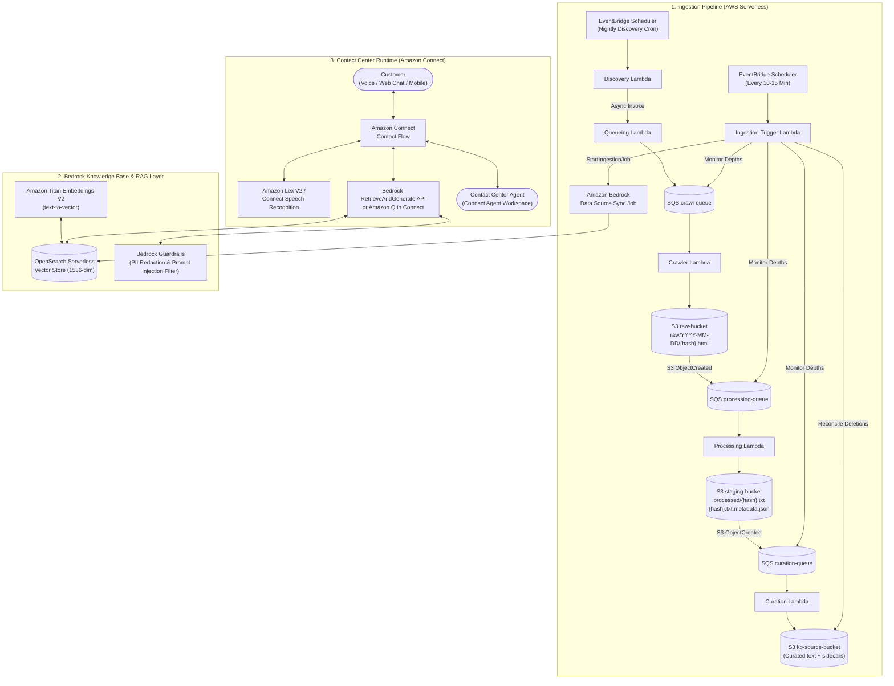
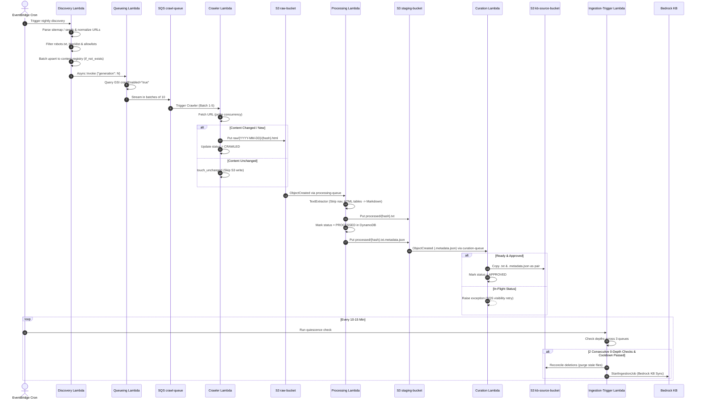
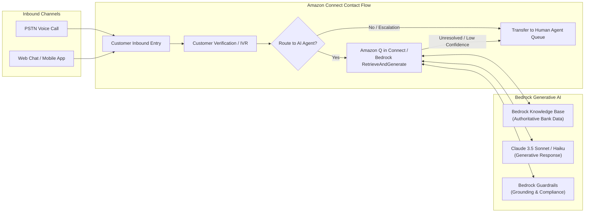

# Low-Level Design (LLD): Custom Web Crawler to Amazon Bedrock Knowledge Base & Amazon Connect AI Agent

**Document Version:** 1.0  
**Status:** Approved / Production-Ready  
**Target Platform:** Amazon Web Services (AWS)  
**Author:** Engineering Team  
**Date:** October 2026  

---

## 1. Executive Summary & Solution Objectives

This Low-Level Design (LLD) document details the architecture, component specifications, data schemas, algorithmic logic, and integration patterns for an enterprise-grade web content crawler and generative RAG (Retrieval-Augmented Generation) pipeline.

The solution automatically crawls, parses, sanitizes, curates, and synchronizes authoritative banking website content into **Amazon Bedrock Knowledge Bases**. The synchronized knowledge is subsequently served in real-time to customers and contact center agents through **Amazon Connect AI Agents** across voice and digital channels (Web Chat, Mobile App, WhatsApp).

### Primary Objectives
1. **Accurate, Grounded Self-Service**: Enable the Amazon Connect AI Agent to answer customer queries (fixed deposit rates, loan criteria, service charges, digital banking guidelines) with zero hallucinations, backed by verifiable `sourceUrl` citations.
2. **Financial Table Integrity**: Preserve tabular data relationships (interest rate slabs, tenure matrix) via HTML-to-Markdown conversion so Bedrock semantic chunking retains table structures intact.
3. **Multi-Stage Defense-in-Depth Curation**: Prevent unvetted, non-banking, or sensitive pages (e.g., login portals, career pages, internal policies) from ever entering the Knowledge Base via regex allowlists, denylists, and an administrative DynamoDB blocklist.
4. **Resilient Event-Driven Lifecycle**: Completely eliminate race conditions, silent message drops, and infinite SQS dead-letter retries using state coordination, conditional DynamoDB writes, and batch-failure isolation.
5. **Seamless Omnichannel Integration**: Integrate with Amazon Connect using Amazon Q in Connect and native Bedrock `RetrieveAndGenerate` APIs within Amazon Connect Contact Flows.

---

## 2. End-to-End System Architecture



---

## 3. Data Store Specifications & Schemas

### 3.1. DynamoDB: `content-registry`
Maintains the lifecycle state and content hashes for every discovered URL.

* **Partition Key**: `urlHash` (String, SHA-256 of normalized URL)
* **Global Secondary Indexes (GSI)**:
  * `crawl-enabled-index`: Partition Key `crawlEnabled` (String: `"true"` / `"false"`), Projection: `url`, `urlHash`.

| Attribute Name | Type | Description | Set By |
| :--- | :--- | :--- | :--- |
| `urlHash` | String | PK: SHA-256 of canonical URL | Discovery |
| `url` | String | Fully normalized URL | Discovery |
| `crawlEnabled` | String | Flag (`"true"` / `"false"`) gating crawl dispatch | Discovery (`if_not_exists`), Manual |
| `ingestionEnabled` | String | Flag (`"true"` / `"false"`) gating promotion to KB | Discovery (`if_not_exists`), Manual |
| `status` | String | Lifecycle state: `DISCOVERED`, `CRAWLED`, `PROCESSED`, `APPROVED`, `REJECTED`, `SUPPRESSED`, `QUARANTINED`, `FAILED_HTTP_xxx`, `DELETED` | All Lambdas |
| `contentHash` | String | SHA-256 hash of raw HTML body for change detection | Crawler |
| `rawS3Key` | String | S3 path in raw bucket (`raw/{YYYY-MM-DD}/{hash}.html`) | Crawler |
| `processedS3Key` | String | S3 path in staging bucket (`processed/{hash}.txt`) | Processing |
| `curatedS3Key` | String | S3 path in KB source bucket | Curation |
| `lastSeenGeneration` | Number | Generation counter when last seen in sitemap | Discovery |
| `crawlGeneration` | Number | Generation counter when last fetched | Crawler |
| `lastCrawledAt` | Number | Unix epoch timestamp of last network fetch | Crawler |
| `processedAt` | Number | Unix epoch timestamp of text processing | Processing |
| `approvedAt` | Number | Unix epoch timestamp of curation approval | Curation |
| `validationNotes` | String | Reason if quarantined or rejected | Processing / Curation |

### 3.2. DynamoDB: `pipeline-state`
Coordinates pipeline run states and prevents concurrency collisions.

* **Partition Key**: `pipelineId` (String: fixed key `"kb-sync"`)

| Attribute Name | Type | Description |
| :--- | :--- | :--- |
| `pipelineId` | String | Primary Key (always `"kb-sync"`) |
| `pipelineStatus` | String | Current pipeline lifecycle: `DISCOVERING` $\rightarrow$ `QUEUEING` $\rightarrow$ `CRAWLING` $\rightarrow$ `INGESTING` $\rightarrow$ `IDLE` |
| `crawlGeneration` | Number | Strictly monotonically increasing integer |
| `lastDiscoveredGeneration` | Number | Generation of the most recent *completed* Discovery run |
| `consecutiveEmptyChecks` | Number | Consecutive checks where all 3 SQS queues had 0 depth |
| `lastIngestionAt` | Number | Unix timestamp of most recently started Bedrock sync job |
| `discoveryStartedAt` | Number | Timestamp when Discovery phase began |
| `discoveryCompletedAt` | Number | Timestamp when Discovery upserts finished |

### 3.3. DynamoDB: `url-blocklist` (Optional Administrative Table)
Allows business/compliance users to instantly block URLs without code deployments.

* **Partition Key**: `url` (String: Full canonical URL)
* **Attributes**: `reason` (String), `addedBy` (String), `addedAt` (Number).

### 3.4. S3 Storage Architecture

| Bucket | Prefix & Key Schema | Content-Type | S3 Object Metadata | Retention Policy |
| :--- | :--- | :--- | :--- | :--- |
| **Raw Bucket** | `raw/{YYYY-MM-DD}/{urlHash}.html` | `text/html` | `source-url`, `final-url` | Lifecycle: Glacier after 30d, expire 90d |
| **Staging Bucket** | `processed/{urlHash}.txt`<br>`processed/{urlHash}.txt.metadata.json` | `text/plain`<br>`application/json` | Standard | Lifecycle: Versioning enabled, retain 30d |
| **KB Source Bucket** | `processed/{urlHash}.txt`<br>`processed/{urlHash}.txt.metadata.json` | `text/plain`<br>`application/json` | Standard | Production source for Bedrock Knowledge Base |

---

## 4. Lambda Function Detailed Specifications



### 4.1. Discovery Lambda (`discovery_lambda.py`)
* **Trigger**: EventBridge Scheduler (Nightly, e.g., `cron(0 1 * * ? *)`).
* **Memory & Timeout**: 1024 MB, 15 minutes.
* **Key Algorithmic Steps**:
  1. Increment `crawlGeneration` and set `pipelineStatus = "DISCOVERING"` in `pipeline-state`.
  2. Parse XML sitemap or recursive `<sitemapindex>` using `urllib.request` with User-Agent `internal-kb-crawler/1.0`.
  3. Canonicalize each URL via `normalize_url`: lowercase scheme/domain, remove trailing slashes (except root), strip tracking queries (`utm_*`, `gclid`, `fbclid`), and sort remaining query parameters.
  4. Fetch and evaluate `/robots.txt` (404/410 fails open; 5xx proceeds without blocking).
  5. Check against DynamoDB `url-blocklist` table and apply regex allowlists (`ALLOW_URL_PATTERNS`) and exclusions (`EXCLUDE_URL_PATTERNS`).
  6. Multithreaded conditional upsert (`ThreadPoolExecutor`, default 20 workers): writes item with `if_not_exists(crawlEnabled, "true")`, `if_not_exists(ingestionEnabled, "true")`, and `if_not_exists(status, "DISCOVERED")`.
  7. Transition `pipelineStatus = "QUEUEING"`, stamp `lastDiscoveredGeneration = N`, and asynchronously invoke Queueing Lambda via `lambda_client.invoke(InvocationType="Event")`.

### 4.2. Queueing Lambda (`queueing_lambda.py`)
* **Trigger**: Asynchronously invoked by Discovery Lambda or manual test payload `{"generation": N}`.
* **Memory & Timeout**: 512 MB, 5 minutes.
* **Key Algorithmic Steps**:
  1. Query GSI `crawl-enabled-index` on `content-registry` where `crawlEnabled = "true"`.
  2. Stream items directly inside the pagination loop (`LastEvaluatedKey`) using a 10-item buffer: dispatches to SQS `crawl-queue` using `sqs.send_message_batch`.
  3. If items enqueued $> 0$, set `pipelineStatus = "CRAWLING"`; if $0$, set `"IDLE"`. Reset `consecutiveEmptyChecks = 0`.

### 4.3. Crawler Lambda (`crawler_lambda.py`)
* **Trigger**: SQS `crawl-queue` (Batch size: 1–5, `ReportBatchItemFailures`: ON).
* **Reserved Concurrency**: 5–10 (protects target bank web server).
* **Key Algorithmic Steps**:
  1. Fetch URL with standard `urllib.request.Request`, 15-second timeout, and custom User-Agent.
  2. Inspect response URL for HTTP redirects; log and save `final-url` in S3 metadata.
  3. **Permanent HTTP Error Handling**: HTTP `404 Not Found` or `410 Gone` updates DynamoDB status to `FAILED_HTTP_{code}` without failing the SQS batch (eliminates DLQ redrive loops).
  4. **Transient Error Handling**: HTTP 5xx or connection timeouts raise `RuntimeError` and return `{"batchItemFailures": [{"itemIdentifier": messageId}]}` for automatic SQS exponential backoff retry.
  5. **Change Detection**: Compute SHA-256 hash of fetched HTML. If equal to `contentHash` in DynamoDB, call `touch_unchanged()` (updates timestamps) and skip S3 upload.
  6. If new or modified, write raw body to S3 `raw/{YYYY-MM-DD}/{urlHash}.html` and set status `CRAWLED`.

### 4.4. Processing Lambda (`processing_lambda.py`)
* **Trigger**: SQS `processing-queue` (fed by S3 `ObjectCreated` on `raw/*.html`, Batch size: 1–5, `ReportBatchItemFailures`: ON).
* **Key Algorithmic Steps**:
  1. Parse S3 Event Notification, fetch raw HTML and `source-url` metadata.
  2. Extract text via `TextExtractor(HTMLParser)`:
     * Omit tags in `SKIP_TAGS` (`script`, `style`, `nav`, `header`, `footer`, `aside`, `noscript`, `svg`, `form`).
     * Convert heading tags (`h1`–`h6`) into Markdown headings (`#`, `##`, etc.).
     * **Markdown Table Preservation**: Convert HTML `<table>` elements into formatted Markdown tables (`| Header | ... | \n | --- | ... |`) and escape pipe characters (`\|`) inside table cells.
     * Drop recurring boilerplate paragraphs matching `BOILERPLATE_PATTERNS` regexes.
  3. Validate extracted text length against `MIN_TEXT_LENGTH` (default 200). If too short, mark status `QUARANTINED` and skip staging upload.
  4. Upload clean text to `staging-bucket` at `processed/{urlHash}.txt`.
  5. **Status Ordering Guarantee**: Call `mark_processed()` updating DynamoDB status to `PROCESSED` **before** uploading the metadata sidecar to S3.
  6. Upload Bedrock metadata sidecar to `staging-bucket` at `processed/{urlHash}.txt.metadata.json`:
     ```json
     {
       "metadataAttributes": {
         "sourceUrl": "https://www.bankofindia.co.in/personal-banking/fixed-deposit",
         "urlHash": "7f8b9c...",
         "pageTitle": "Fixed Deposit Interest Rates | Bank of India"
       }
     }
     ```

### 4.5. Curation Lambda (`curation_lambda.py`)
* **Trigger**: SQS `curation-queue` (fed by S3 `ObjectCreated` on staging `*.metadata.json`, Batch size: 1–5, `ReportBatchItemFailures`: ON).
* **Key Algorithmic Steps**:
  1. Read `.metadata.json` sidecar and extract `urlHash` and `sourceUrl`.
  2. Lookup item in DynamoDB `content-registry`.
  3. **Race Condition Protection**: If item status is `DISCOVERED`, `CRAWLED`, or `None`, raise `RuntimeError` to return message to SQS for retry via visibility timeout.
  4. If status is already terminal (`QUARANTINED`, `SUPPRESSED`, `REJECTED`, `DELETED`), skip without copying.
  5. **Approval Gates**:
     * Gate 1: Check `ingestionEnabled == "true"`. If false, set status `SUPPRESSED`.
     * Gate 2: Check DynamoDB `url-blocklist` table. If matched, set status `REJECTED`.
     * Gate 3: Check `CURATION_ALLOW_PATTERNS`. If set and not matched, set status `REJECTED`.
     * Gate 4: Check `CURATION_EXCLUDE_PATTERNS`. If matched, set status `REJECTED`.
  6. **Dual S3 Copy**: Use `s3.copy_object` to copy both `processed/{urlHash}.txt` and companion `processed/{urlHash}.txt.metadata.json` into `kb-source-bucket`.
  7. Update DynamoDB status to `APPROVED` and record `curatedS3Key`.

### 4.6. Ingestion-Trigger Lambda (`ingestion_trigger_lambda.py`)
* **Trigger**: EventBridge Scheduler (rate: every 10–15 minutes).
* **Key Algorithmic Steps**:
  1. Inspect status of previous Bedrock ingestion job via `bedrock_agent.list_ingestion_jobs`; alert if `FAILED`.
  2. Inspect `pipelineStatus` in `pipeline-state`: if `DISCOVERING` or `QUEUEING`, exit immediately (pipeline is still dispatching crawl work).
  3. Query queue depths across all 3 queues (`crawl`, `processing`, `curation`) using `ApproximateNumberOfMessages` and `ApproximateNumberOfMessagesNotVisible`.
  4. If total messages $> 0$, reset `consecutiveEmptyChecks = 0` and exit.
  5. If `pipelineStatus == "IDLE"` and depth $= 0$, exit (nothing new to sync).
  6. Increment `consecutiveEmptyChecks`. If $< \text{REQUIRED\_EMPTY\_CHECKS}$ (default 2), exit to await confirmation check.
  7. Attempt atomic slot claim via conditional update in DynamoDB (`attribute_not_exists(lastIngestionAt) OR lastIngestionAt < :cutoff`).
  8. **Deletion Reconciliation**: Scan `content-registry` for items where `lastSeenGeneration < lastDiscoveredGeneration` and `status != "DELETED"`.
     * For each stale item: delete both the content text file and the companion `.metadata.json` sidecar from `kb-source-bucket`.
     * Update DynamoDB status to `DELETED`.
  9. Call `bedrock_agent.start_ingestion_job(knowledgeBaseId, dataSourceId)`.
  10. Set `pipelineStatus = "IDLE"` in `pipeline-state`.

---

## 5. Amazon Bedrock Knowledge Base Configuration

### 5.1. Vector Store & Embedding Model
* **Vector Database**: Amazon OpenSearch Serverless (AOSS) Collection (Vector Search type).
* **Vector Index Configuration**:
  * Dimension: 1536 (or 1024 depending on model configuration).
  * Metric: Cosine Similarity / HNSW (Hierarchical Navigable Small World).
* **Embedding Model**: `amazon.titan-embed-text-v2` (supports normalized vector embeddings and multilingual text).

### 5.2. Chunking Strategy for Preserved Markdown
* **Chunking Type**: Hierarchical Chunking or Semantic Chunking.
* **Maximum Chunk Size**: 800–1000 tokens with 15% overlap.
* **Delimiter Alignment**: Because `processing_lambda.py` flushes blocks on double newlines (`\n\n`) and emits Markdown tables as contiguous blocks, Bedrock's chunker treats each financial table and section heading as a cohesive semantic unit without splitting rows across chunk boundaries.

### 5.3. Sidecar Metadata Schema in Bedrock
When Bedrock indexes `processed/{urlHash}.txt`, it automatically reads `processed/{urlHash}.txt.metadata.json`:

```json
{
  "metadataAttributes": {
    "sourceUrl": "https://www.bankofindia.co.in/rates/fixed-deposits",
    "urlHash": "e3b0c44298fc1c149afbf4c8996fb92427ae41e4649b934ca495991b7852b855",
    "pageTitle": "Interest Rates on Term Deposits | Bank of India"
  }
}
```
* **Filterable Attributes**: In Amazon Connect or Bedrock API calls, queries can restrict search space using metadata filters (e.g., `sourceUrl` prefix or `pageTitle`).

### 5.4. Amazon Bedrock Guardrails
* **Content Filters**: High threshold on Hate, Insults, Sexual, Violence.
* **Prompt Injection Defense**: Filters adversarial prompt injections embedded in public web pages.
* **Sensitive Information (PII) Redaction**: Automatically masks PAN numbers, Aadhaar numbers, credit card numbers, and phone numbers in synthesized responses.
* **Contextual Grounding Filter**: Rejects model output if grounding score against retrieved chunks is below 0.75 (prevents ungrounded answers).

---

## 6. Amazon Connect AI Agent Integration Architecture

Amazon Connect integrates with the synchronized Bedrock Knowledge Base through two primary patterns depending on channel requirements.



### 6.1. Integration Pattern A: Amazon Q in Connect (Native AI Agent Assistant)

Amazon Q in Connect uses Generative AI to provide real-time recommendations and customer-facing automated responses.

1. **Configuration**:
   * Create an Amazon Q in Connect Assistant (`aiAgent`).
   * Add a **Knowledge Base Content Association** linking directly to the Amazon Bedrock Knowledge Base ID:
     ```bash
     aws qconnect create-content-association \
       --assistant-id <connect-assistant-id> \
       --association-type BEDROCK_KNOWLEDGE_BASE \
       --association '{"bedrockKnowledgeBase": {"knowledgeBaseArn": "<bedrock-kb-arn>"}}'
     ```
2. **Behavior**:
   * **Self-Service Mode**: Automated chat bot directly queries the Knowledge Base and streams responses.
   * **Agent-Assist Mode**: During a live voice call with a human agent, Connect Contact Lens transcribes customer speech in real time, queries the Bedrock KB, and displays the exact answer card with source URLs in the agent's desktop widget.

### 6.2. Integration Pattern B: Direct Contact Flow via Bedrock `RetrieveAndGenerate` API

For custom voice IVR prompts or direct digital bot flows, Amazon Connect calls a lightweight Orchestrator Lambda or native Bedrock Contact Flow block.

#### Runtime Request Schema
```python
import boto3

bedrock_runtime = boto3.client("bedrock-agent-runtime", region_name="ap-south-1")

def query_knowledge_base(customer_query, session_id=None):
    request_params = {
        "input": {"text": customer_query},
        "retrieveAndGenerateConfiguration": {
            "type": "KNOWLEDGE_BASE",
            "knowledgeBaseConfiguration": {
                "knowledgeBaseId": "KB_ID_FROM_INGESTION_TRIGGER",
                "modelArn": "arn:aws:bedrock:ap-south-1::foundation-model/anthropic.claude-3-5-haiku-20241022-v1:0",
                "generationConfiguration": {
                    "promptTemplate": {
                        "textPromptTemplate": (
                            "You are a helpful customer service AI agent for Bank of India. "
                            "Answer the customer's question strictly using the provided search results. "
                            "If the search results do not contain the answer, say 'I apologize, but I do not "
                            "have verified information on that topic. Let me connect you with a representative.' "
                            "Never invent interest rates, penalty charges, or policy rules.\n\n"
                            "Search Results:\n$search_results$\n\n"
                            "Customer Question: $query$\n\nAnswer:"
                        )
                    },
                    "guardrailConfiguration": {
                        "guardrailId": "GUARDRAIL_ID",
                        "guardrailVersion": "DRAFT"
                    }
                }
            }
        }
    }
    if session_id:
        request_params["sessionId"] = session_id

    response = bedrock_runtime.retrieve_and_generate(**request_params)
    answer_text = response["output"]["text"]
    citations = response.get("citations", [])
    
    # Extract source citation URL from metadataAttributes
    sources = []
    for c in citations:
        for ref in c.get("retrievedReferences", []):
            attrs = ref.get("metadata", {})
            if "sourceUrl" in attrs:
                sources.append(attrs["sourceUrl"])

    return {
        "answer": answer_text,
        "sourceUrls": list(set(sources)),
        "sessionId": response.get("sessionId")
    }
```

---

## 7. Amazon Connect Contact Flow Step-by-Step Execution

| Step # | Contact Flow Block | Execution Action | Fallback / Condition |
| :---: | :--- | :--- | :--- |
| **1** | **Set Voice & Logging** | Set text-to-speech engine to Amazon Polly Neural Voice (`Aditi` for Indian English / Hindi). Turn on Contact Flow logging. | Next |
| **2** | **Get Customer Input** | Prompt: *"How can I help you today?"* Captured via Amazon Lex V2 Intent or natural language speech input. | 3 invalid attempts $\rightarrow$ Transfer to Human Agent |
| **3** | **Invoke AI Agent** | Passes customer utterance to Bedrock `RetrieveAndGenerate` API with session context. | Timeout ($> 3000\text{ms}$) $\rightarrow$ Step 7 |
| **4** | **Evaluate Grounding** | Checks if Bedrock Guardrails intervened or if the response returned *"I apologize, but I do not have verified information..."* | Not grounded $\rightarrow$ Step 7 |
| **5** | **Deliver Response** | **Voice**: Plays synthesized audio response.<br>**Chat**: Displays Markdown answer and appends verified citation links: `[Official Page](sourceUrl)`. | Next |
| **6** | **Check Resolution** | Prompt: *"Did that answer your question?"* If Yes $\rightarrow$ Disconnect; If No $\rightarrow$ Step 7. | Customer dissatisfied $\rightarrow$ Step 7 |
| **7** | **Transfer to Queue** | Set contact attributes (`lastCustomerIntent`, `bedrockQuery`, `aiResponseSnippet`). Transfer call to `Banking-Specialist-Queue` with screen-pop for agent. | Queue Full $\rightarrow$ Voicemail / Callback |

---

## 8. Security, Compliance & Governance

1. **Least-Privilege IAM Roles**:
   * Each of the 6 Lambdas runs with an isolated execution role scoped strictly to required table names and S3 prefixes.
   * `curation_lambda` has `s3:GetObject` on `staging-bucket` and `s3:PutObject` on `kb-source-bucket`.
   * `ingestion_trigger_lambda` has `bedrock:StartIngestionJob` and `bedrock:ListIngestionJobs` restricted to the specific `KNOWLEDGE_BASE_ID` and `DATA_SOURCE_ID`.
2. **Encryption**:
   * S3 Buckets: SSE-KMS with customer-managed keys (CMK) and bucket policies enforcing `aws:SecureTransport: true` (TLS 1.3).
   * DynamoDB: Encrypted at rest using AWS KMS.
   * OpenSearch Serverless: Enforced encryption at rest and in transit.
3. **Data Residency**:
   * All AWS components (Lambdas, DynamoDB, S3, Bedrock, OpenSearch, Amazon Connect) deployed in `ap-south-1` (Mumbai) in compliance with local banking regulations.
4. **Administrative Controls**:
   * Instant emergency suppression of any URL without code deployment by setting `ingestionEnabled = "false"` in DynamoDB or adding the URL to `url-blocklist`.

---

## 9. Observability & Troubleshooting Runbook

### 9.1. CloudWatch Alarms
* **Queue Backlog Alarms**: Alert via SNS if `ApproximateNumberOfMessagesVisible > 0` on `crawl-dlq`, `processing-dlq`, or `curation-dlq`.
* **Crawler Error Alarm**: Metric filter alerting on `[ERROR]` occurrences across Lambda log groups.
* **Bedrock Ingestion Failure Alarm**: EventBridge rule on Bedrock Ingestion Job status `FAILED` targeting DevOps team.

### 9.2. Key CloudWatch Insights Queries

#### Trace a Specific URL Across All 6 Lambdas
```sql
fields @timestamp, @logStream, @message
| filter @message like /https:\/\/www.bankofindia.co.in\/rates\/fd/ or @message like /e3b0c44298fc1c/
| sort @timestamp asc
| limit 100
```

#### Identify SQS Batch Item Failures & Retries
```sql
fields @timestamp, @message
| filter @message like /Failed processing SQS messageId/ or @message like /batchItemFailures/
| sort @timestamp desc
| limit 50
```

#### Monitor Ingestion Quiescence & Trigger Cycles
```sql
fields @timestamp, @message
| filter @message like /Pipeline check/ or @message like /Consecutive empty checks/ or @message like /Successfully started Bedrock ingestion job/
| sort @timestamp desc
| limit 50
```
